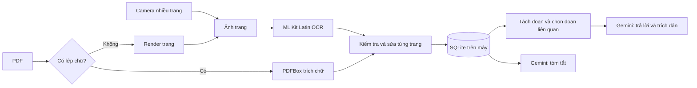
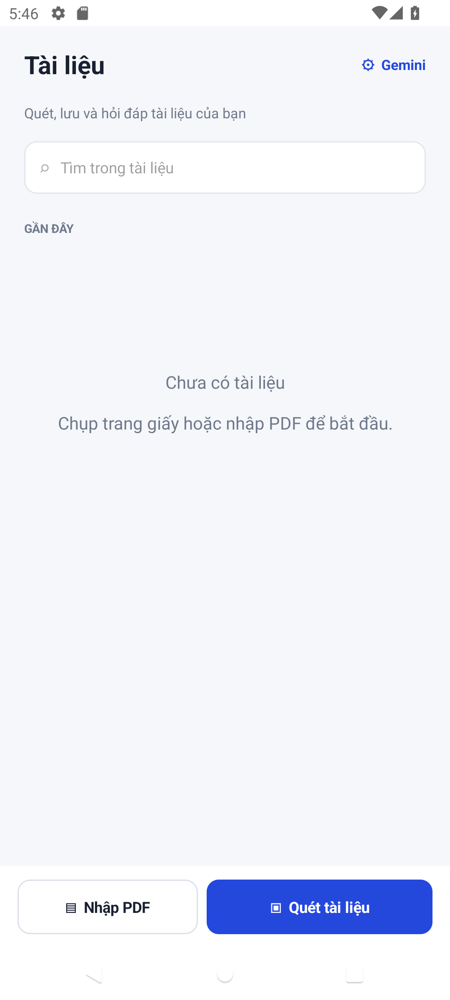
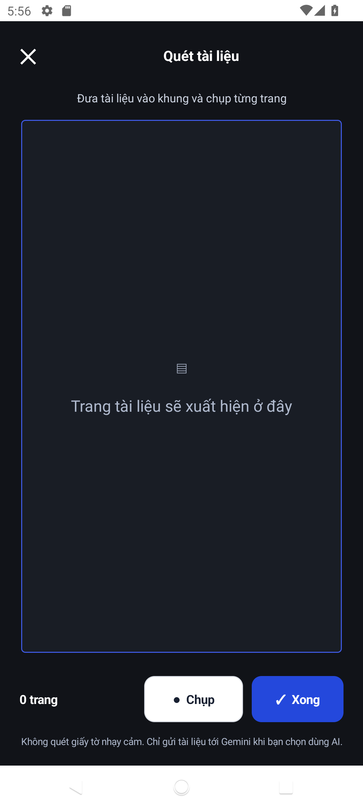
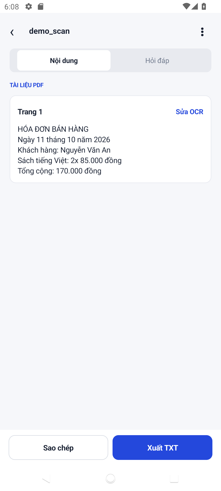
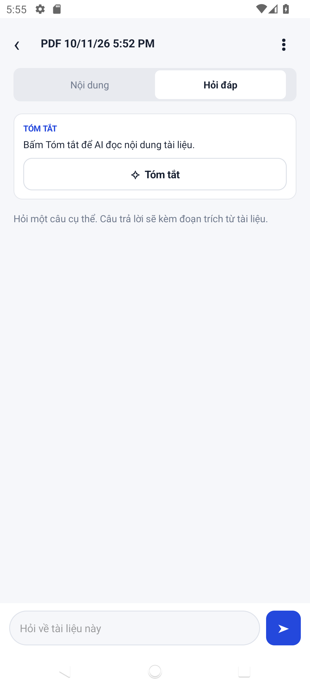

# DocuAsk — AI Document Scanner

Ứng dụng Android đọc tài liệu giấy/PDF, nhận diện chữ tiếng Việt, lưu trên máy và hỏi đáp có đoạn tham chiếu. Giao diện gồm Thư viện, Quét và Chi tiết/Hỏi đáp theo bản phác thảo trong `Screenshot 2026-10-11 173444.png`.

## Tính năng

- Chụp nhiều trang qua ứng dụng camera của máy; cắt vùng sáng khi phát hiện viền đủ rõ, sau đó OCR bằng ML Kit Latin chạy ngoại tuyến.
- Nhập PDF tối đa 50 trang. Trang có lớp chữ được trích trực tiếp bằng PDFBox; trang scan được render và OCR.
- SQLite lưu tên, nguồn, thời gian, từng trang, đường dẫn ảnh, văn bản và tóm tắt. Có tìm kiếm, đổi tên, xóa, sửa OCR từng trang, copy và xuất TXT.
- Gemini nhận các đoạn liên quan nhất để trả lời, kèm nhãn trang/đoạn và đoạn tham chiếu; có nút tóm tắt. API key do người dùng nhập và chỉ giữ trong bộ nhớ phiên chạy, không đóng gói vào APK.
- Có thông báo lỗi mạng, key, quota, PDF quá dài; giao diện nhắc tránh quét giấy tờ nhạy cảm.

## Cài và chạy

APK release 1.0.1 đã ký nằm tại `D:\DocuAsk\release\DocuAsk-v1.0.1.apk` trong workspace cục bộ (không đẩy lên Git). Cài trên Android 8.0 trở lên. Nếu điện thoại đã cài **bản debug** trước đó, hãy dùng `D:\DocuAsk\release\DocuAsk-v1.0.1-phone-update.apk` để cập nhật mà không gỡ app; bản release có chữ ký khác và Android sẽ từ chối cập nhật trực tiếp. Muốn dùng tóm tắt/hỏi đáp, tạo key tại [Google AI Studio](https://aistudio.google.com/app/apikey), mở `⚙ Gemini` trong Thư viện rồi nhập key. OCR và đọc tài liệu đã lưu không cần mạng. Mỗi lần mở lại app cần nhập lại key.

Gemini có thể tạm thời trả lỗi 503 khi model quá tải. Từ 1.0.1 app tự thử lại tối đa ba lần với khoảng chờ tăng dần; nếu vẫn bận, app hiển thị thông báo tiếng Việt để thử lại sau. Lỗi này không có nghĩa API key sai.

Để biên dịch: mở thư mục này bằng Android Studio, dùng JDK 17+ và Android SDK 34, chạy `:app:assembleDebug`. Để tạo APK release đã ký, giữ `release/signing.properties` và keystore được nêu trong đó rồi chạy `:app:assembleRelease`. Hai tệp ký không được đưa lên Git; **hãy sao lưu chúng ở nơi riêng tư** vì thiếu chúng sẽ không thể cập nhật APK bằng cùng danh tính ký.

## Luồng xử lý

## Kiểm thử hiện có

- `:app:assembleDebug` và `:app:assembleRelease` thành công; APK release 1.0.1 được xác minh chữ ký v2. Bản cập nhật tương thích chữ ký debug đã cài và mở được trên điện thoại đang dùng mà không cần gỡ app.
- Emulator Android 12: đã nhập PDF scan tiếng Việt và PDF có lớp chữ; đã kiểm tra văn bản lưu trong SQLite. APK release cài và mở được, không thấy crash. Ảnh màn hình nằm trong [screenshots](screenshots/); [video demo khoảng 53 giây](demo/DocuAsk-demo.mp4) cho thấy luồng giao diện.
- Một hóa đơn **giả lập** cho ML Kit Latin: CER 0,008 và WER 0,077. Đây chỉ là smoke test, không phải so sánh engine trên tài liệu thật. Cách đo nằm trong [benchmark/README.md](benchmark/README.md); chạy `python tools/benchmark_ocr.py benchmark/fixtures/pairs.csv` để tái lập.

## Giới hạn cần kiểm tra trên máy thật

- Camera mở ứng dụng camera hệ thống; khung Quét trong app hiển thị ảnh đã chụp, chưa có live preview. Cắt viền dùng vùng sáng hình chữ nhật, chưa hiệu chỉnh phối cảnh; người dùng cần kiểm tra/sửa OCR.
- Chưa có bộ 10–15 tài liệu thật cùng bản chép chuẩn để so sánh ML Kit/Tesseract/Gemini hoặc đo tỷ lệ trả lời đúng. Đã ghi nhận Gemini trả lỗi quá tải trên điện thoại; chưa xác nhận lượt tóm tắt/hỏi đáp thành công bằng key thật sau bản sửa. Nội dung gửi tới Gemini khi dùng AI có thể chịu chính sách dữ liệu của tier mà key đang dùng.
- Q&A chỉ xét tối đa bốn đoạn liên quan nhất; tài liệu rất dài có thể cần tìm kiếm tinh hơn. Tóm tắt lấy mẫu từ nhiều vị trí khi văn bản vượt ngưỡng.

## Ảnh giao diện

| Thư viện | Quét | Chi tiết | Hỏi đáp |
|---|---|---|---|
|  |  |  |  |

## Công nghệ

Android Java, SQLite, ML Kit Text Recognition v2, PdfBox-Android, Gemini `generateContent` REST. Không có server hoặc đăng nhập. Mã nguồn và dữ liệu tài liệu ở trên thiết bị; việc gửi đoạn văn bản sang Gemini chỉ xảy ra sau khi người dùng bấm tóm tắt hoặc gửi câu hỏi.
